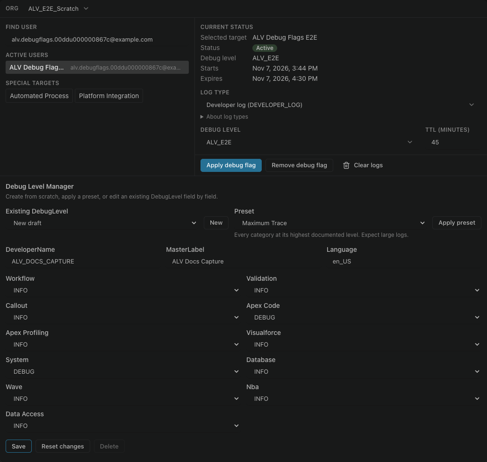

# Turn on debug flags

Salesforce writes an Apex log only while a trace flag is active for the user. If the list stays empty after you run your code, a missing flag is the usual reason.

In the panel, select **Debug Flags**, pick the user and a debug level, and apply it. Run your code again, then refresh the list.

