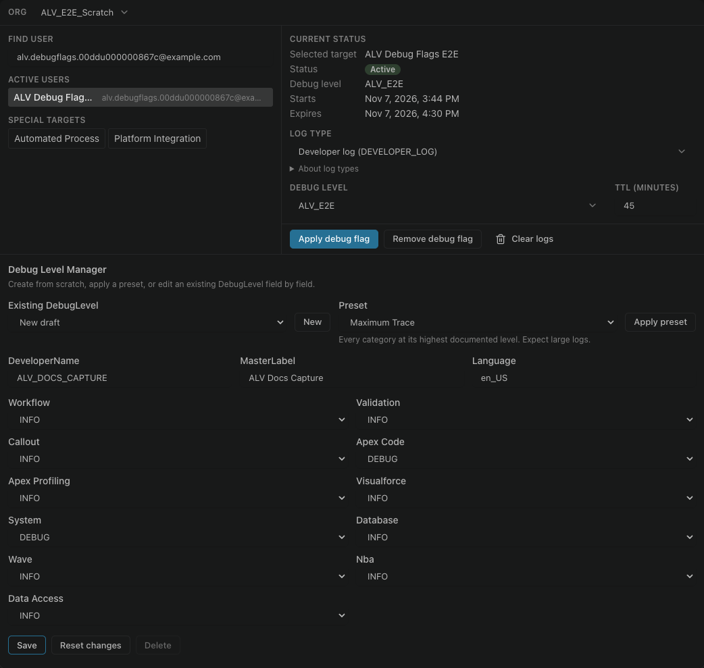

# Ative os debug flags

O Salesforce só grava um log do Apex enquanto há um trace flag ativo para o usuário. Se a lista continua vazia depois de você executar seu código, a falta do flag costuma ser o motivo.

No painel, selecione **Debug Flags**, escolha o usuário e um nível de debug, e aplique. Execute seu código de novo e atualize a lista.

