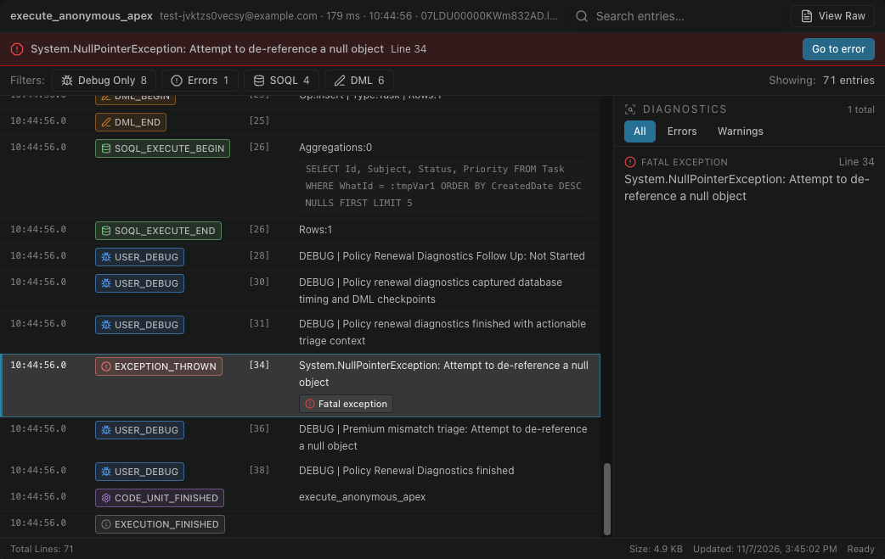

# Open a log and go to the error

Select the log icon at the end of a row to open it in the Log Viewer. Turn on **Errors** to keep only the lines that failed.

In the panel, **Errors only** narrows the list to the logs that contain an error.

