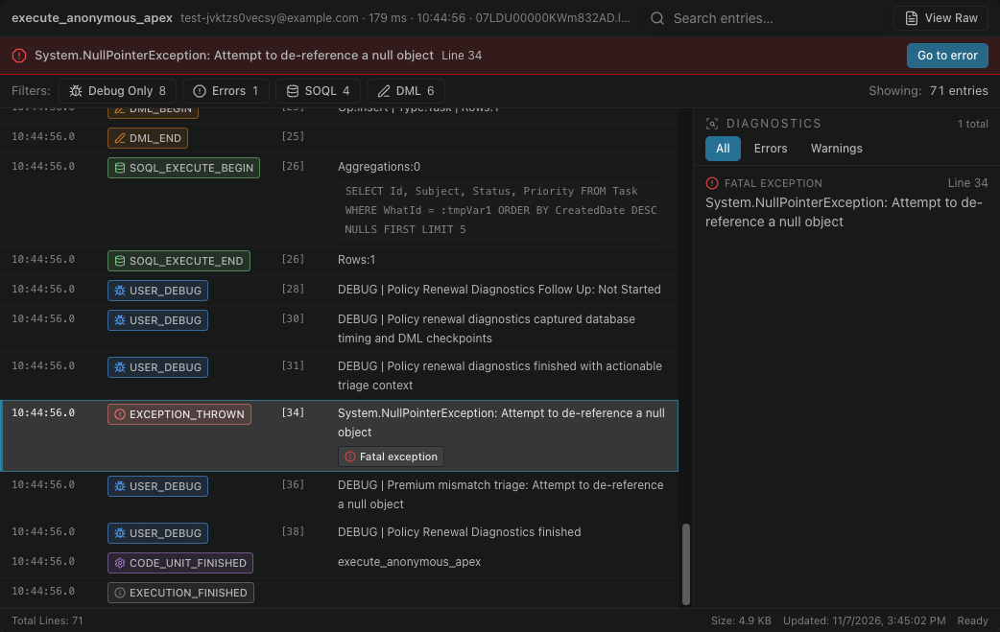

# Abra um log e vá até o erro

Selecione o ícone de log no fim de uma linha para abri-lo no Log Viewer. Ative **Erros** para manter só as linhas que falharam.

No painel, **Somente erros** reduz a lista aos logs que contêm um erro.

